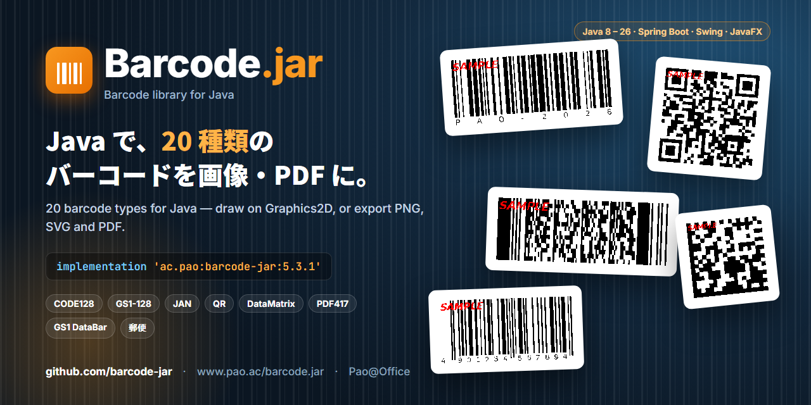
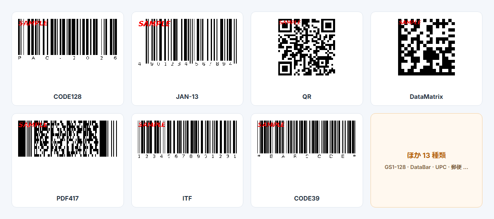

<p align="center">
  
</p>

<p align="center">
  <a href="https://www.pao.ac/barcode.jar/"><b>製品ページ</b></a> ·
  <a href="https://central.sonatype.com/artifact/ac.pao/barcode-jar"><b>Maven Central</b></a> ·
  <a href="https://www.pao.ac/barcode.jar/buy.html"><b>ご購入</b></a> ·
  <a href="https://www.pao.ac/barcode.jar/file/barcode.jar.pdf"><b>マニュアル（PDF）</b></a>
</p>

## Barcode.jar — Java のバーコードライブラリ

**20 種類のバーコード**を、Java の Graphics2D に描いたり、PNG・SVG・PDF に出力したりできます。Spring Boot の Web アプリから、デスクトップのアプリ、帳票の PDF まで、同じ書き方で使えます。

```gradle
implementation 'ac.pao:barcode-jar:5.3.1'
```

```java
Code128 bar = new Code128(graphics2d);      // どの Graphics2D にも描ける
bar.draw("PAO-2026", 20, 20, 320, 110);     // 値, X, Y, 幅, 高さ
```

<p align="center"></p>

## サンプル

| サンプル | 内容 | 状態 |
|---|---|---|
| [**springboot**](https://github.com/barcode-jar/springboot) | Spring Boot の Web アプリ。ブラウザで選んだバーコードを画像・SVG・PDF（Apache PDFBox）に出力。Docker ですぐ起動 | 公開中 |
| [**javafx**](https://github.com/barcode-jar/javafx) | JavaFX のデスクトップアプリ。20 種類をその場でプレビューし、PNG・SVG 保存と印刷 | 公開中 |

## 対応バーコード

CODE128 · GS1-128 · CODE39 · CODE93 · NW7（Codabar）· ITF · Matrix 2of5 · NEC 2of5 · JAN-13 · JAN-8 · UPC-A · UPC-E · GS1 DataBar（標準型・限定型・拡張型）· QR コード · DataMatrix（GS1 対応）· PDF417 · コンビニ収納代行 · 郵便カスタマバーコード

## 体験版と製品版

Maven Central の `ac.pao:barcode-jar` は**体験版**です。出力に赤い「SAMPLE」の印が付きます（QR コードなど 2 次元のコードは、印が重なるため読み取れないことがあります）。[製品版](https://www.pao.ac/barcode.jar/buy.html)をご購入いただくと、印のない出力になります。サンプルのコードは MIT ライセンスです。

---

## Barcode.jar — barcode library for Java (English)

Draw **20 barcode types** on any Java `Graphics2D`, or export them as PNG, SVG and PDF — from Spring Boot web apps to desktop apps and PDF reports.

- Maven Central: `ac.pao:barcode-jar` (trial edition — output carries a red "SAMPLE" mark; the [licensed edition](https://www.pao.ac/barcode.jar/) has none)
- Samples: [springboot](https://github.com/barcode-jar/springboot) (Spring Boot web app, Docker-ready) · [javafx](https://github.com/barcode-jar/javafx) (JavaFX desktop app)
- Product page: https://www.pao.ac/barcode.jar/

<sub>© Pao@Office · Sample code under the MIT License.</sub>
